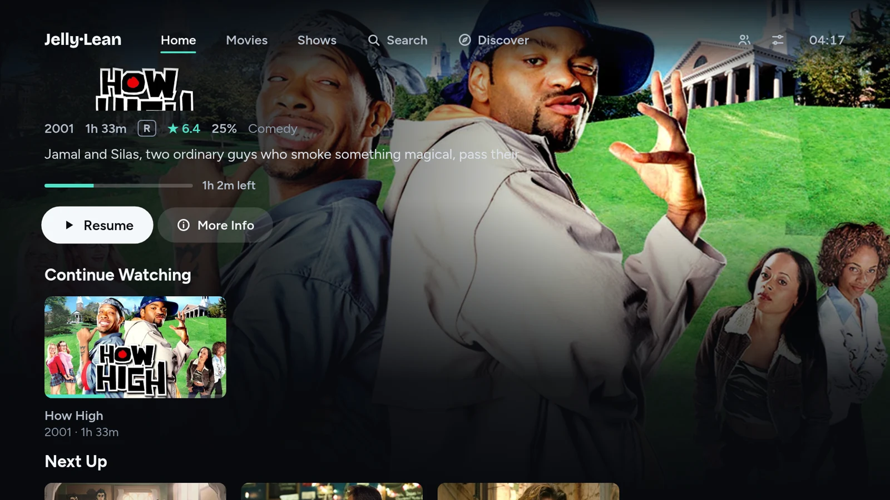
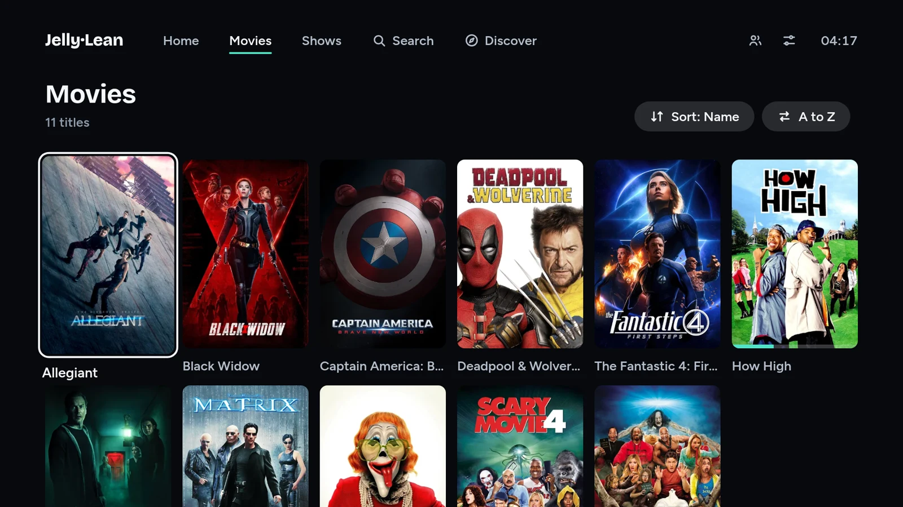
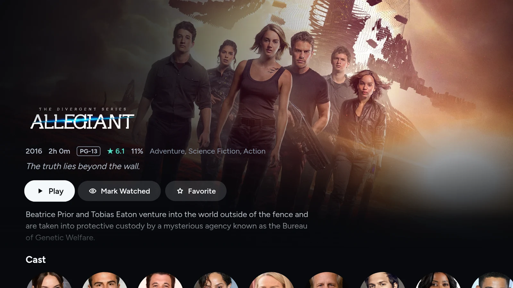

<div align="center">
  

  # JellyLean

  **A light, remote-first Jellyfin client for Samsung Tizen TVs.**

  [](../../releases/latest)
  
  
  [](LICENSE)

  [Features](#features) • [Install](#install) • [Build](#build-from-source) • [Development](#development) • [Troubleshooting](#troubleshooting)
</div>



JellyLean is a hand-written Jellyfin client for Samsung Tizen TVs. The official
`jellyfin-tizen` build ships the full jellyfin-web bundle, which is heavy on older
hardware; JellyLean is plain ES5 with no framework and no build step, and talks to
Jellyfin's REST and WebSocket APIs directly.

Built and tested on a **UE43M5602** (2017 M5 series, Tizen 3.0, 1080p); it should
run on any Tizen TV from 2015 onwards.

> [!TIP]
> Just want it on your TV? Grab the signed `JellyLean.wgt` from the
> [latest release](../../releases/latest) and follow [Install](#install).

## Features

- **Browse** — Continue Watching hero, a latest row per library, full library
  grids, details with seasons and episodes, unified search, and Discover
  (Jellyseerr / Overseerr, see [Connecting Seerr](#connecting-seerr)).
- **Play** — Samsung AVPlay hardware decoding with an HTML5 fallback, automatic
  transcode retry when direct play fails, up-next autoplay, resume positions and
  watched state.
- **Subtitles and audio** — a per-title subtitle picker (remembered per movie and
  per series) and an audio-track picker. Text subtitles are fetched as WebVTT and
  drawn by the client, so they do not force a transcode; image subtitles
  (PGS/VOBSUB) restart with a burn-in.
- **Skip Intro / Credits / Recap** — Jellyfin 10.10 Media Segments, with a fallback
  to the Intro Skipper plugin on 10.8/10.9.
- **SyncPlay** — create or join a group, clock-offset estimation, shared queue,
  play/pause/seek routing, buffering/ready reports and drift correction.
- **Remote-first UI** — four-way spatial navigation, an OSD control row, a playback
  info panel and inline SVG icons. No pointer required.
- **Opt-in bitrate cap** — uncapped and pinned to 1080p by default; cap it to
  2–40 Mbps in Settings if the TV or network struggles with high-bitrate remuxes.
- **Small and static** — no runtime dependencies, no framework, no build step.

## Screenshots

| Movies | Details |
| :---: | :---: |
|  |  |

## Requirements

| Component | Requirement |
| --- | --- |
| **TV** | Tizen 2.3 or newer (targets the `tv` profile, Tizen 3.0), developer mode enabled, and a network path to your Jellyfin server. |
| **Server** | Jellyfin 10.9 or newer, verified against 12.4.0. SyncPlay needs 10.8+; Media Segments need 10.10+. For Skip Intro on 10.8/10.9, install the [Intro Skipper](https://github.com/jellyfin/jellyfin-plugin-intros) plugin. |
| **Build machine** | Tizen Studio CLI (`web-cli_Tizen_Studio_6.1`), `zip`, and Node.js 18+ for the dev server and tests. |

A direct network path is required: `http://192.168.x.x:8096`, or HTTPS with a
certificate the TV trusts. Self-signed certificates are usually rejected.

## Connecting Seerr

Discover talks to your own Seerr (Jellyseerr / Overseerr). Open
**Settings → Discover** and choose how to connect. Nothing is typed in Settings
itself: each option opens its own short screen that asks only for what it needs.

- **Quick Connect** — nothing to type. The TV asks Seerr for a code and approves
  it with its own Jellyfin login, so requests are made as you. Needs Seerr 3.4 or
  newer, signed in to the same Jellyfin. If the TV cannot approve the code itself
  it shows it, and you enter it in Jellyfin → Settings → Quick Connect on another
  device.
- **Use Jellyfin Password** — asks for your Jellyfin password once. Also makes
  requests as you.
- **Use API Key** — asks for the key (Seerr → Settings → General). Requests are
  made as the key's owner, usually the admin. A key Seerr rejects is not kept.

The first time, the option also asks for the **Seerr address**, starting from your
Jellyfin host on port 5055. Change it later from the *Seerr address* row. The
field is always in the top half of the screen, so it stays visible above the TV
keyboard.

## Install

### 1. Enable developer mode on the TV

1. Open **Apps**, highlight **App Store** (or any app tile), and press `12345` on
   the remote.
2. Turn **Developer mode** on and enter the IP address of the computer that will
   install the app.
3. Reboot the TV.

The TV now listens for `sdb` on TCP 26101.

### 2. Install the widget

Download `JellyLean.wgt` from the [latest release](../../releases/latest), then:

```bash
scripts/install.sh --scan                 # find TVs on the local network
scripts/install.sh --ip 192.168.1.50      # install
scripts/install.sh --ip 192.168.1.50 --run
```

Or install manually:

```bash
sdb connect 192.168.1.50:26101
tizen install -n JellyLean.wgt -s 192.168.1.50:26101
tizen run -p jflean0001.JellyfinLean -s 192.168.1.50:26101
```

Apps2Samsung users can install JellyLean from the community catalog.

> [!NOTE]
> Releases are signed and install on retail TVs in developer mode. They use the
> Apps2Samsung signing pair; if your TV rejects it, rebuild with a Samsung-issued
> certificate. The Tizen ids (`jflean0001.JellyLean`, package `jflean0001`) predate
> the JellyLean name and are kept so an update replaces an existing install instead
> of adding a second app.

## Build from source

The Tizen CLI is found on `PATH` or in `~/tizen-studio` automatically.

A retail TV only installs widgets signed with a trusted certificate. Put
`author.p12` and `distributor.p12` in `~/.tizen-certs`, then create the signing
profile once:

```bash
scripts/setup-signing.sh
# override the certificate paths, password or profile:
CERT_DIR=... CERT_PASSWORD=... PROFILE=... scripts/setup-signing.sh
```

Then build:

```bash
scripts/build.sh                        # signed widget, active profile
TIZEN_PROFILE=MyTVProfile scripts/build.sh
scripts/build.sh --unsigned             # inspection / browser only
```

The result is `dist/JellyLean.wgt`. The script reports whether the widget actually
contains both signatures.

> [!NOTE]
> On headless machines Tizen CLI 6.x fails with `CertificationException: Invaild
> password` because it cannot reach a Secret Service provider. `setup-signing.sh`
> installs a small file-backed `secret-tool` shim for that case.

## First run

1. Start the app and enter the server address, e.g. `192.168.1.20:8096` or
   `https://jellyfin.example.com`.
2. Sign in with a username and password, or use **Quick Connect**.
3. The server URL, access token and user id are stored in the TV's `localStorage`.
   **Settings → Sign out** removes the token.

The app generates a stable per-install device id, which Jellyfin uses to keep
sessions and SyncPlay participants apart.

## Development

### Mock server

The dev server serves the app and a small mock Jellyfin API from one origin:

```bash
node scripts/dev-server.js          # http://localhost:8096
PORT=8097 node scripts/dev-server.js
```

Enter `localhost:8096` and any username/password. The mock provides two libraries,
a movie, a series with a season and episode, working images, intro segments,
WebVTT subtitles, a generated test video, and a SyncPlay group stub.

`NO_MOCK=1 node scripts/dev-server.js` serves only the static app, which is how to
drive the real client against a real Jellyfin by hand. Reset the client with
`localStorage.clear()`.

### Tests

```bash
node test/smoke.js        # headless Chromium UI test; fails on console errors
node test/live.js         # read-only checks against a real server
node test/syncplay.js     # SyncPlay state machine and drift correction
node test/osd.js          # OSD fade (skipped when jsdom is not installed)
node scripts/check-design.js
```

The live test signs in through the real setup screen and checks rows, images,
segments, negotiation, subtitles and the SyncPlay socket without changing watch
state:

```bash
JF_URL=http://192.168.1.20:8096 JF_USER=me JF_PASS=secret node test/live.js
```

`SHOTS=1 node test/smoke.js` writes screenshots to `.dev/screenshots`;
`CHROME=/path/to/chromium` selects a browser.

## Remote controls

| Key | Outside playback | During playback |
| --- | --- | --- |
| Arrows | Move focus | Seek ±10s (←/→), focus Skip/controls (↑), leave focus (↓) |
| ←/→ while a control is focused | — | Move between rewind / play / forward / info |
| OK | Activate focused item | Play/pause, or activate the focused control |
| INFO | — | Toggle the playback info panel |
| BACK | Previous screen | Close the info panel if open, otherwise stop and go back |
| EXIT | Exit the app | Stop and exit |
| Play/Pause | — | Toggle playback |
| Stop | — | Stop and go back |
| FF / Rewind | — | Seek ±30s |

SyncPlay changes the meaning of pause and seek: the command goes to the server and
is applied when it comes back, so everyone stays together.

## How it works

```
config.xml      Tizen widget manifest (package jflean0001)
index.html      static shell: #app for screens, #stage + #osd for video
css/app.css     TV stylesheet — flexbox only, no grid/gap/custom properties
js/api.js       Jellyfin REST client, device profile, WebSocket
js/player.js    AVPlay + HTML5 playback engine, stall watchdog
js/subtitles.js WebVTT parsing and the cue overlay
js/syncplay.js  SyncPlay group, queue, time sync, commands, drift
js/screens/     setup, home, library, detail, player, search, discover, syncplay, settings
scripts/        build, install, signing setup, dev server
test/           smoke, live, syncplay, osd
```

**Playback.** `/Items/{id}/PlaybackInfo` negotiates against a device profile that
claims H.264 up to 1080p and AAC/MP3/AC3/E-AC3. HEVC is deliberately not claimed:
a UHD remux would direct-play to a black picture on this panel, so the server
transcodes it instead. Transcoded streams are uncapped but pinned to 1920x1080
through `maxWidth`/`maxHeight`, because Jellyfin otherwise derives the resolution
from the bitrate. A direct stream that errors, or reports no frames for 12 seconds,
is retried once through HLS.

**Subtitles.** Text tracks are fetched as WebVTT and drawn over the video, so an
embedded `subrip` track does not force a transcode. Subtitle parameters are
stripped from transcode URLs unless the viewer picked an image track; PGS/VOBSUB
tracks are burned in by the server.

**SyncPlay.** `/GetUtcTime` estimates the clock offset NTP-style and the WebSocket
carries `SyncPlayCommand` and `SyncPlayGroupUpdate` messages. Commands are
scheduled by server timestamp with drift correction while playing. Starting an
item in a group sends `SetNewQueue` so every participant follows the same queue.

**Compatibility.** One code path serves Jellyfin 10.x and 12.x: both auth header
forms, repeated query keys instead of comma-joined lists, and both `api_key` and
`ApiKey` WebSocket spellings.

## Limitations

- No Live TV/DVR, playlists, or dedicated music UI.
- Image subtitles restart playback briefly while the server burns them in.
- HEVC and DTS are never claimed, so a 4K HEVC remux always transcodes (by design).
- HTTPS requires a certificate the TV trusts; a self-signed certificate will fail.
- The token is stored unencrypted in the TV's web storage — sign out before
  handing the TV on.
- SyncPlay needs reasonably accurate clocks; the client measures the offset but
  cannot fix a server whose clock jumps.

## Troubleshooting

**`CertificationException: Invaild password` while building** — the Tizen CLI
cannot read the certificate password. Run `scripts/setup-signing.sh`, then rebuild.

**`Invalid certificate chain` on install** — the widget is unsigned or signed with
the wrong profile. Rebuild with a Samsung author certificate and
`TIZEN_PROFILE=<profile>`.

**`scripts/install.sh --scan` finds no TV** — developer mode is off, the computer's
IP was not entered on the TV, or they are on different subnets. Reboot the TV after
changing developer mode.

**Audio but no picture** — check **Settings → Last playback** and confirm the
transcode URL carries `maxWidth=1920&maxHeight=1080`; enable **Settings → Force
transcoding**; and make sure the built `index.html` still loads
`$WEBAPIS/webapis/webapis.js`, otherwise AVPlay is skipped.

**Skip Intro never appears** — needs Jellyfin 10.10+ Media Segments, or the Intro
Skipper plugin on 10.8/10.9, and analysed episodes.

**SyncPlay drifts** — check that `/GetUtcTime` is reachable (some reverse proxies
block it) and that the server clock is stable.

**Every API call returns 401** — rebuild after pulling; Jellyfin 12.x requires the
`Authorization: MediaBrowser …, Token="…"` header.

## Disclaimer

JellyLean is an independent, unofficial project. It is not affiliated with,
endorsed by, or sponsored by the Jellyfin project, Samsung Electronics, the
Seerr/Jellyseerr/Overseerr projects, or TMDB.

- **Jellyfin** is free software; this client uses its public REST and WebSocket APIs
  and contains none of its code.
- **Samsung Tizen / AVPlay** is provided by the TV firmware at runtime and is not
  redistributed here.
- **TMDB / JustWatch** provide Discover artwork and availability data. This product
  uses the TMDB API but is not endorsed or certified by TMDB.
- **Fonts** (Figtree, Bricolage Grotesque) are under the SIL Open Font License 1.1;
  their license texts are in [`fonts/`](fonts/).

Artwork shown in the app belongs to its rights holders and comes from your own
server; none is shipped in this repository.

MIT licensed — see [LICENSE](LICENSE). Security policy: [SECURITY.md](SECURITY.md).
